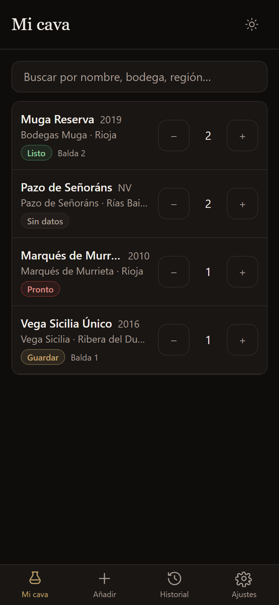

# Mi Cava

Cava doméstica para hasta 250 botellas. Meter y sacar stock con un toque, sin
cuentas ni servidores: todo vive en el navegador del móvil o del ordenador.



## Qué hace

- **Mi cava**: lista con buscador instantáneo (sin acentos ni mayúsculas), semáforo
  de apogeo (Listo · Guardar · Pronto · Sin datos) y botones `−` / `+` en cada fila.
  Toca la fila (o el número de botellas) para abrir la ficha del vino: notas de cata,
  ubicación, ventana de consumo, ajuste de stock y todos sus movimientos.
- **Añadir**: alta rápida con la fecha de hoy ya puesta. La añada rellena sola la
  ventana de consumo (añada + 3 a añada + 12). Si ya existe el mismo vino, la botella
  se suma en vez de duplicar la fila.
- **Historial**: cada descorche con su fecha y su nota, agrupado por mes. Los vinos
  que se quedan a cero pasan a "Fuera de la cava" sin perder nada, con un botón para
  devolverlos.
- **Ajustes**: estadísticas (botellas, referencias, valor estimado, reparto por tipo
  y por estado), tema claro/oscuro e importación/exportación.

## Cómo correrlo

```powershell
npm.cmd install
npm.cmd run dev
```

Abre <http://localhost:5173>. (En PowerShell `npm` puede estar bloqueado por la
política de ejecución; `npm.cmd` funciona siempre.)

Comprobaciones: `npm.cmd test`, `npm.cmd run typecheck`, `npm.cmd run lint`,
`npm.cmd run build` y `npm.cmd run preview` para servir el build.

## Instalarlo en el móvil

Publica la carpeta `dist/` en cualquier hosting estático con HTTPS (Netlify,
Vercel, GitHub Pages, Cloudflare Pages…) y abre esa URL en el móvil:

- **Android (Chrome)**: menú ⋮ → "Instalar aplicación" / "Añadir a pantalla de inicio".
- **iPhone (Safari)**: compartir → "Añadir a la pantalla de inicio".

Queda a pantalla completa y funciona sin conexión: la app y sus datos están en el
dispositivo.

## Copias de seguridad (importante)

Los datos viven **solo en el navegador de ese dispositivo** (IndexedDB). Si borras
los datos del sitio, cambias de móvil o desinstalas la app, se pierden. Por eso:

**Ajustes → Exportar JSON** descarga una copia completa (vinos + historial de
descorches). Para recuperarla: **Importar archivo** y elige ese JSON; se restaura
tal cual, sin duplicar. Hazlo de vez en cuando.

`Exportar CSV` genera un CSV compatible con CellarTracker (y con hojas de cálculo),
pero es una copia parcial: no lleva el historial de descorches ni las referencias a
cero botellas. Para restaurar, usa el JSON.

## Importar desde otra app

**Ajustes → Importar archivo** acepta `.csv` o `.json`.

- CSV con cabecera: se detectan solas las columnas habituales (CellarTracker,
  exportaciones propias, hojas de cálculo). Acepta `,` `;` o tabulador como separador,
  también con coma decimal (`18,90`). Si algo no encaja, la pantalla de mapeo deja
  asignar cada columna a mano y elegir si las fechas son `dd/mm/aaaa` o `mm/dd/aaaa`.
- JSON propio (el de **Exportar JSON**) se restaura tal cual, con su historial.
- JSON plano (solo una lista de vinos, sin `id`) se fusiona por nombre, añada y bodega.
  Su `history` no se importa: para conservar los descorches usa el JSON propio.
- Antes de escribir nada verás un resumen: vinos nuevos, vinos que se suman a uno
  existente (mismo nombre, añada y bodega), posibles duplicados de otra bodega y
  líneas con error. Cada posible duplicado se puede añadir como vino nuevo o fusionar
  con el existente.
- Las filas se fusionan sumando botellas: importar dos veces el mismo archivo
  duplica el stock, así que revisa el resumen antes de aplicar.

## Escáner de etiquetas (opcional)

En **Añadir** puedes fotografiar la etiqueta y rellenar nombre, bodega, añada,
región y varietales automáticamente. Necesita una clave de API de Google Gemini,
que se guarda solo en este navegador (`localStorage`) y se envía únicamente a
Google al escanear. Sin clave no se envía nada: la app funciona igual escribiendo
los datos a mano.

## Estructura

```
src/
  db/          esquema Dexie, repositorio (journal de eventos) y backups
  domain/      reglas puras: normalización, búsqueda, ventana de consumo, dedupe, estadísticas
  services/    exportadores CSV/JSON, importador, escáner de etiquetas (mock y Gemini)
  features/    pantallas: cellar, add, history, settings
  components/  kit de UI (Button, Sheet, Toast, nav, badges…)
  hooks/       tema, toasts, datos en vivo
  lib/         fechas, dinero, descarga de archivos
tests/         pruebas de las reglas y del repositorio (Vitest + fake-indexeddb)
docs/          diseño, plan de implementación y capturas
```

El stock nunca se guarda como un número suelto: se deriva de un journal de eventos
(`add`, `consume`, `import`, `undo`), de modo que el historial y el stock no pueden
contradecirse y deshacer es exacto.

## Licencia

MIT. Ver [LICENSE](LICENSE).
